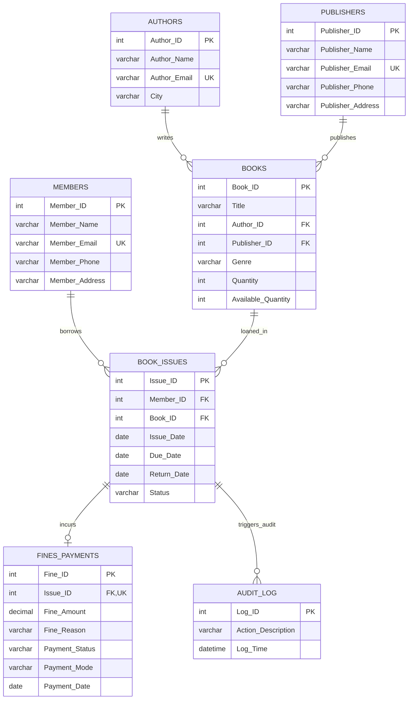

# Library Management System &mdash; Technical Project Documentation
**Course Code**: DMS 313302 &bull; **Curriculum**: MSBTE K-Scheme &bull; **Program**: Diploma in Computer Engineering / Information Technology  
**Database**: MySQL 8.0 &bull; **Application**: Python Flask &bull; **Operating System**: Microsoft Windows  

---

## 1. Introduction

### 1.1 Project Overview
The **Library Management System (LMS)** is an end-to-end relational database application engineered to automate the daily circulation, cataloging, and financial penalty management of a college library. The system replaces error-prone physical register books with an ACID-compliant MySQL database and an intuitive, responsive web-based circulation desk interface.

### 1.2 Problem Statement
Traditional paper-based or uncoupled library systems encounter frequent anomalies, including:
- Members borrowing more books than permitted by library policy.
- Over-allocation of books beyond available physical inventory.
- Duplicate loans of the same title to the same student.
- Manual and imprecise calculation of late return fines.
- Lack of an automated audit log to track inventory movements.

### 1.3 System Objectives
1. **Enforce Business Rules at the Database Level**: Encapsulate all circulation rules directly within MySQL stored procedures, triggers, functions, check constraints, and views.
2. **ACID Transaction Guarantee**: Ensure atomicity and consistency during high-concurrency circulation operations (issuing and returning books) using row-level locking (`FOR UPDATE`) and explicit transaction boundaries (`START TRANSACTION`, `COMMIT`, `ROLLBACK`).
3. **Automate Inventory Sync & Fine Tracking**: Dynamically adjust `Available_Quantity` on book issues/returns and compute late return penalties automatically at Rs. 5.00/day.
4. **Human-Friendly Error Translation**: Intercept technical SQL exception codes and signals (`SQLSTATE 45000`, `1062`, `1451`) and translate them into clear, actionable messages for circulation staff.

---

## 2. System Architecture

The project follows a standard **Three-Tier Architecture**:

```
+-------------------------------------------------------------+
|                     PRESENTATION TIER                       |
|   HTML5, CSS3 Responsive Grid, Vanilla JS, Jinja2 Templates |
|          (Browser interface for desktop and mobile)         |
+-------------------------------------------------------------+
                              | HTTP / JSON
                              v
+-------------------------------------------------------------+
|                     APPLICATION TIER                        |
|       Python 3 (Flask Framework) + db.py Data Broker        |
|  - Input Validation & Session Authentication                |
|  - Stored Routine Invocations                               |
|  - Human-Friendly Error Translation Layer                   |
+-------------------------------------------------------------+
                              | MySQL Protocol (TCP 3306)
                              v
+-------------------------------------------------------------+
|                       DATABASE TIER                         |
|                 MySQL 8.0 InnoDB Storage Engine             |
|  - Relational Tables, PK/FK/UK/CHECK Constraints            |
|  - Stored Procedures: issue_book, return_book, pay_fine...  |
|  - Stored Functions: fn_calculate_fine, fn_check_avail...   |
|  - Trigger: trg_return_audit -> Audit_Log                   |
|  - View: Current_Issued_Books                               |
|  - Explicit Cursor: list_overdue_books                      |
+-------------------------------------------------------------+
```

---

## 3. Entity-Relationship (ER) Diagram



---

## 4. Table Descriptions & Schema Specifications

### 4.1 Table: `Authors`
Stores metadata regarding authors who have written cataloged books.
- **`Author_ID`** (`INT`, `AUTO_INCREMENT`, `PRIMARY KEY`): Unique author identifier.
- **`Author_Name`** (`VARCHAR(50)`, `NOT NULL`): Full name of the author.
- **`Author_Email`** (`VARCHAR(50)`, `NOT NULL`, `UNIQUE` constraint `UK_Author_Email`): Author contact email.
- **`City`** (`VARCHAR(50)`): Author city of origin/residence.

### 4.2 Table: `Publishers`
Maintains publishing house contact information.
- **`Publisher_ID`** (`INT`, `AUTO_INCREMENT`, `PRIMARY KEY`): Unique publisher identifier.
- **`Publisher_Name`** (`VARCHAR(50)`, `NOT NULL`): Name of the publishing company.
- **`Publisher_Email`** (`VARCHAR(50)`, `NOT NULL`, `UNIQUE` constraint `UK_Publisher_Email`): Corporate email.
- **`Publisher_Phone`** (`VARCHAR(15)`): Telephone contact.
- **`Publisher_Address`** (`VARCHAR(100)`): Registered physical office address.

### 4.3 Table: `Books`
Stores library book titles and manages inventory quantities.
- **`Book_ID`** (`INT`, `AUTO_INCREMENT`, `PRIMARY KEY`): Unique accession number.
- **`Title`** (`VARCHAR(100)`, `NOT NULL`): Complete title of the publication.
- **`Author_ID`** (`INT`, `NOT NULL`, `FOREIGN KEY` referencing `Authors(Author_ID)`).
- **`Publisher_ID`** (`INT`, `NOT NULL`, `FOREIGN KEY` referencing `Publishers(Publisher_ID)`).
- **`Genre`** (`VARCHAR(50)`, `NOT NULL`): Subject category (e.g. Technology, Fiction).
- **`Quantity`** (`INT`, `NOT NULL`, `CHECK (Quantity > 0)`): Total purchased physical copies.
- **`Available_Quantity`** (`INT`, `NOT NULL`, `CHECK (Available_Quantity >= 0 AND Available_Quantity <= Quantity)`): Physical copies currently present on library shelves.

### 4.4 Table: `Members`
Maintains records of registered library patrons (students and staff).
- **`Member_ID`** (`INT`, `AUTO_INCREMENT`, `PRIMARY KEY`): Unique membership card number.
- **`Member_Name`** (`VARCHAR(50)`, `NOT NULL`): Full name of patron.
- **`Member_Email`** (`VARCHAR(50)`, `NOT NULL`, `UNIQUE` constraint `UK_Member_Email`): Contact email.
- **`Member_Phone`** (`VARCHAR(15)`): Primary contact phone number.
- **`Member_Address`** (`VARCHAR(100)`): Residential/campus address.

### 4.5 Table: `Book_Issues`
Circulation ledger tracking every loan transaction.
- **`Issue_ID`** (`INT`, `AUTO_INCREMENT`, `PRIMARY KEY`): Unique loan transaction identifier.
- **`Member_ID`** (`INT`, `NOT NULL`, `FOREIGN KEY` referencing `Members(Member_ID)`).
- **`Book_ID`** (`INT`, `NOT NULL`, `FOREIGN KEY` referencing `Books(Book_ID)`).
- **`Issue_Date`** (`DATE`, `NOT NULL`): Date book was checked out.
- **`Due_Date`** (`DATE`, `NOT NULL`, `CHECK (Due_Date >= Issue_Date)`): Return deadline (Issue_Date + 14 days).
- **`Return_Date`** (`DATE`, `CHECK (Return_Date IS NULL OR Return_Date >= Issue_Date)`): Actual return date.
- **`Status`** (`VARCHAR(20)`, `NOT NULL`, `CHECK (Status IN ('Issued', 'Returned'))`): Current state of loan.

### 4.6 Table: `Fines_Payments`
Tracks monetary penalties for books returned past the due date.
- **`Fine_ID`** (`INT`, `AUTO_INCREMENT`, `PRIMARY KEY`): Fine invoice number.
- **`Issue_ID`** (`INT`, `NOT NULL`, `UNIQUE` constraint `UK_Fine_Issue`, `FOREIGN KEY` referencing `Book_Issues(Issue_ID)`).
- **`Fine_Amount`** (`DECIMAL(10,2)`, `NOT NULL`, `CHECK (Fine_Amount >= 0)`): Overdue penalty amount (Rs. 5.00/day late).
- **`Fine_Reason`** (`VARCHAR(100)`, `NOT NULL`): Reason for charge ('Late return').
- **`Payment_Status`** (`VARCHAR(20)`, `NOT NULL`, `CHECK (Payment_Status IN ('Pending', 'Paid'))`): Settlement status.
- **`Payment_Mode`** (`VARCHAR(20)`): Mode of settlement ('Cash', 'UPI', 'Card').
- **`Payment_Date`** (`DATE`): Date fine was collected.

### 4.7 Table: `Audit_Log`
System-wide audit trail automatically populated by database triggers.
- **`Log_ID`** (`INT`, `AUTO_INCREMENT`, `PRIMARY KEY`): Sequential log record identifier.
- **`Action_Description`** (`VARCHAR(255)`): Text description of event (e.g. 'Book returned. Issue ID: 12').
- **`Log_Time`** (`DATETIME`): Exact timestamp of event occurrence.

---

## 5. Database Normalization Analysis

Database normalization is the formal process of structuring a relational database to minimize redundancy and eliminate data modification anomalies (insertion, update, and deletion anomalies).

### 5.1 First Normal Form (1NF)
**Rule**: A table is in 1NF if all column values are atomic (indivisible), each attribute has a unique name, and there are no repeating groups.
- In our schema, every field contains atomic values (e.g., `Author_Name`, `Publisher_Phone`, `Due_Date`).
- Multiple books authored by an author are not stored in a comma-separated column; instead, each book is a distinct tuple in `Books` referencing `Author_ID`.
- Hence, all tables satisfy **1NF**.

### 5.2 Second Normal Form (2NF)
**Rule**: A table is in 2NF if it is in 1NF and every non-prime attribute is fully functionally dependent on the entire primary key (no partial functional dependency).
- All tables in this schema use single-column artificial surrogate keys as their primary keys (`Author_ID`, `Publisher_ID`, `Book_ID`, `Member_ID`, `Issue_ID`, `Fine_ID`, `Log_ID`).
- Since no composite primary keys exist, partial functional dependency is mathematically impossible.
- Every non-key attribute depends entirely on the primary key of its relation.
- Hence, all tables satisfy **2NF**.

### 5.3 Third Normal Form (3NF)
**Rule**: A table is in 3NF if it is in 2NF and has no transitive dependencies (non-prime attributes must not functionally determine other non-prime attributes; $X \rightarrow Y$ implies $X$ is a superkey).
- In `Books`, author details (`Author_Name`, `Author_Email`, `City`) and publisher details (`Publisher_Name`, `Publisher_Phone`, `Publisher_Address`) are intentionally separated into `Authors` and `Publishers` tables, referenced solely through foreign keys `Author_ID` and `Publisher_ID`.
- In `Book_Issues`, member details are referenced through `Member_ID`, and book details through `Book_ID`. No borrower contact info or book genres are stored redundantly in `Book_Issues`.
- In `Fines_Payments`, the record references `Issue_ID` only; all borrower and title information is joined dynamically at query time.
- Hence, all tables are fully compliant with **3NF**.

---

## 6. Index of Database Concepts Used & Locations

| # | DBMS Concept | SQL Feature / Syntax | Project Implementation & Location in `Library_Management_System.sql` |
| :---: | :--- | :--- | :--- |
| **1** | **DDL** (Data Definition Language) | `CREATE DATABASE`, `CREATE TABLE` | Lines 10–133: Creation of all seven primary entities. |
| **2** | **Primary Key Constraints** | `PRIMARY KEY AUTO_INCREMENT` | Applied to every entity (`Book_ID`, `Member_ID`, `Issue_ID`, etc.). |
| **3** | **Foreign Key Constraints** | `FOREIGN KEY ... REFERENCES` | `FK_Book_Author`, `FK_Book_Publisher`, `FK_Issue_Member`, `FK_Issue_Book`, `FK_Fine_Issue`. |
| **4** | **Unique Constraints** | `CONSTRAINT ... UNIQUE` | `UK_Author_Email`, `UK_Publisher_Email`, `UK_Member_Email`, `UK_Fine_Issue`. |
| **5** | **Check Constraints** | `CHECK (...)` | `CHK_Quantity (>0)`, `CHK_Available_Quantity (0<=Avail<=Qty)`, `CHK_Issue_Status`, `CHK_Due_Date`, `CHK_Return_Date`, `CHK_Fine_Amount`. |
| **6** | **DML** (Data Manipulation) | `INSERT`, `UPDATE`, `DELETE` | Lines 151–240: Seed data insertion and sample update/delete routines. |
| **7** | **Basic SELECT Filtering** | `WHERE`, `ORDER BY`, `DISTINCT`, `BETWEEN`, `LIKE` | Lines 254–276: Query filtering across genre, date, and member names. |
| **8** | **Aggregate Functions** | `COUNT()`, `SUM()`, `AVG()`, `MAX()`, `MIN()`, `GROUP BY`, `HAVING` | Lines 282–307: Shelf count calculations, genre groupings, average copy counts. |
| **9** | **String & Date Functions** | `UPPER()`, `LOWER()`, `CONCAT()`, `CURDATE()`, `DATE_ADD()`, `DATEDIFF()` | Lines 312–326 & Procedure logic: Computing 14-day due date intervals and overdue days. |
| **10** | **INNER JOIN** | `INNER JOIN ... ON` | Lines 332–341: Multi-table join connecting `Books`, `Authors`, and `Publishers`. |
| **11** | **LEFT OUTER JOIN** | `LEFT JOIN ... ON` | Lines 344–355: Joining `Members` to `Book_Issues` to include members with 0 loans. |
| **12** | **Subqueries** | `WHERE ... IN (SELECT ...)` | Lines 362–376: Subqueries to identify above-average quantities and active borrowers. |
| **13** | **Set Operations** | `UNION` | Lines 382–387: Combining author and member directories into a single name stream. |
| **14** | **Indexes** | `CREATE INDEX` | Line 393: `idx_issue_member_book` on `Book_Issues(Member_ID, Book_ID)` for fast composite lookups. |
| **15** | **Database Views** | `CREATE OR REPLACE VIEW` | Lines 401–416: `Current_Issued_Books` view exposing active loans without exposing underlying structure. |
| **16** | **Deterministic Stored Functions** | `CREATE FUNCTION ... RETURNS INT` | Lines 422–438: `fn_check_availability(p_book_id)` reading current stock. |
| **17** | **Dynamic Stored Functions** | `CREATE FUNCTION ... RETURNS DECIMAL` | Lines 446–472: `fn_calculate_fine(p_issue_id)` dynamically evaluating days late and computing Rs. 5/day fine. |
| **18** | **Database Triggers** | `CREATE TRIGGER ... AFTER UPDATE` | Lines 480–499: `trg_return_audit` automatically inserting audit events into `Audit_Log` on return. |
| **19** | **Stored Procedures** | `CREATE PROCEDURE ... BEGIN ... END` | Lines 514–861: `issue_book`, `return_book`, `pay_fine`, `list_overdue_books`. |
| **20** | **Exception Handling & Signals** | `DECLARE EXIT HANDLER`, `SIGNAL SQLSTATE '45000'` | Used throughout procedures to guarantee rollback and emit human-readable business rule errors. |
| **21** | **Explicit Cursors & Handlers** | `CURSOR FOR`, `FETCH`, `CONTINUE HANDLER FOR NOT FOUND` | Lines 809–854: In `list_overdue_books()` to traverse overdue records row-by-row into a temporary table. |
| **22** | **TCL** (Transaction Control) | `START TRANSACTION`, `COMMIT`, `ROLLBACK`, `SAVEPOINT` | Lines 535, 641, 674, 738, 883–945: ACID transactions and rollback point demonstration. |
| **23** | **Row-Level Concurrency Locking** | `SELECT ... FOR UPDATE` | Lines 560–564 & 689–693: Pessimistic locking in `issue_book` and `return_book` to prevent race conditions. |
| **24** | **DCL** (Data Control Language) | `CREATE USER`, `GRANT`, `REVOKE` | Lines 870–880: User privilege delegation for role-based security (`library_staff`). |

---

## 7. Comprehensive Testing Table

The test suite in `test_system.py` was executed directly against the live MySQL database. All 11 automated test cases passed.

| Test ID | Feature / Rule Under Test | Input / Action | Expected Result | Actual Result | Status |
| :---: | :--- | :--- | :--- | :--- | :---: |
| **TC-01** | **Issue Book Success** | Member ID = 1, Book ID = 5 | Book issued; Confirmation slip returned; Stock decremented by 1. | Issue slip created; Due date set to +14 days; Available copies reduced by 1. | **PASS** |
| **TC-02** | **Prevent Duplicate Issue** | Member ID = 1, Book ID = 5 (re-issue) | Rejected with message showing original issue date. | Rejected: `Book ... was already issued on 2026-10-04. Please return it first.` | **PASS** |
| **TC-03** | **Enforce 3-Book Limit** | Member with 3 active loans attempts to issue 4th book | Rejected; Plain-language error lists the 3 currently held books and dates. | Rejected: `Member has reached the limit of 3 books. Currently borrowed: ...` | **PASS** |
| **TC-04** | **Zero Stock Rejection** | Issue book with `Available_Quantity = 0` | Rejected with book name and out-of-stock notification. | Rejected: `The book '...' is currently unavailable (all copies are issued).` | **PASS** |
| **TC-05** | **Invalid Entity Validation** | Issue with non-existent Member or Book ID (99999) | Handled gracefully without raw database stack traces. | Rejected: `Member does not exist.` / `Book does not exist.` | **PASS** |
| **TC-06** | **Book Return & Stock Restore** | Call `return_book(issue_id)` on active loan | Return confirmed; Available quantity incremented; Trigger fires. | Stock replenished; `Audit_Log` entry created: `Book returned. Issue ID: ...` | **PASS** |
| **TC-07** | **Late Return Fine Generation** | Return loan backdated 6 days past due date | Late return flagged; `Fines_Payments` record created with Rs. 30.00 (Pending). | Fine of ₹ 30.00 created with status 'Pending' using `fn_calculate_fine`. | **PASS** |
| **TC-08** | **Fine Settlement (`pay_fine`)** | Settle pending fine using Mode = 'UPI' | Fine marked 'Paid'; Mode recorded; Duplicate payment rejected. | Fine status changed to 'Paid' on CURDATE(); Duplicate payment rejected. | **PASS** |
| **TC-09** | **Overdue Cursor Traversal** | Call `list_overdue_books()` procedure | Explicit cursor populates and returns all loans where `Due_Date < CURDATE()`. | Returns table with Issue ID, Borrower, Book Title, Due Date, Days Late. | **PASS** |
| **TC-10** | **Total Copies Invariant Check** | Increase total copies (+3); Attempt to reduce below borrowed count | Available copies increases by +3; Reducing below active loans blocked. | Invariant maintained: Available copies updated; Reduction below loans prevented. | **PASS** |
| **TC-11** | **Integrity & Constraint Guards** | Insert duplicate email; Delete author with books | Handled with friendly plain-language constraint error messages. | Rejected: `A member with this email is already registered.` / `Cannot delete...` | **PASS** |

---

## 8. Conclusion & Future Scope

### 8.1 Conclusion
The College Library Management System successfully unifies an enterprise-grade MySQL relational database design with an accessible, robust Python Flask web interface. By enforcing core business constraints directly at the database engine level (using procedures, triggers, functions, and check constraints), the system guarantees data integrity regardless of how many client applications interface with the database. The plain-language error translation layer shields circulation staff from technical database jargon while presenting actionable instructions.

### 8.2 Future Scope
1. **Barcode / RFID Scanner Integration**: Replace manual dropdown selections with USB barcode or RFID scanners for instantaneous accession book checkout.
2. **Automated SMS & Email Overdue Reminders**: Scheduled background daemon (cron) sending automated WhatsApp or Email reminders to students 2 days prior to the 14-day due date.
3. **Student Self-Service Portal**: Provide read-only search access (OPAC - Online Public Access Catalog) enabling students to check book availability and place online reservation holds from mobile phones.
4. **Digital Payment Gateway Integration**: Connect the UPI fine collection route to a live payment gateway (Razorpay / PayU) generating dynamic QR codes.
